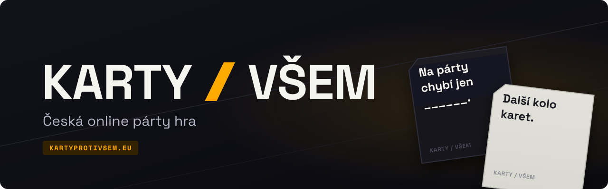

 
 

**An online multiplayer party card game in Czech.** 
Each round a black card is drawn and one player is the czar. Everyone else answers it with
white cards from their hand, and the czar picks the best answer, scoring a point for whoever
played it.

 

---

## Play

No download, no account needed. Open [kartyprotivsem.eu](https://kartyprotivsem.eu), pick a
name, and create a room or join one by its code. Sign in with Google or Discord to keep your
game history and build your own decks.

New to the game? [Jak se hraje](https://kartyprotivsem.eu/rules) explains the rules.

## Follow along

| Where                                                     | What you find there                             |
| --------------------------------------------------------- | ----------------------------------------------- |
| [Roadmap](https://roadmap.kartyprotivsem.eu)              | What is planned, in progress and released       |
| [Changelog](https://roadmap.kartyprotivsem.eu/changelog/) | What changed in every version                   |
| [Discord](https://discord.gg/RuE88KcA2X)                  | Announcements, feedback and people to play with |

## Contact

Ideas and bug reports are welcome on [Discord](https://discord.gg/RuE88KcA2X). For legal
matters and content reports, write to
[legal@kartyprotivsem.eu](mailto:legal@kartyprotivsem.eu).

---

  <b>KARTY / VŠEM</b> - za hranou? Teprve začínáme.

